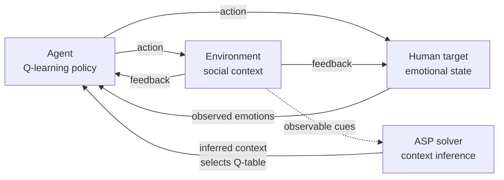
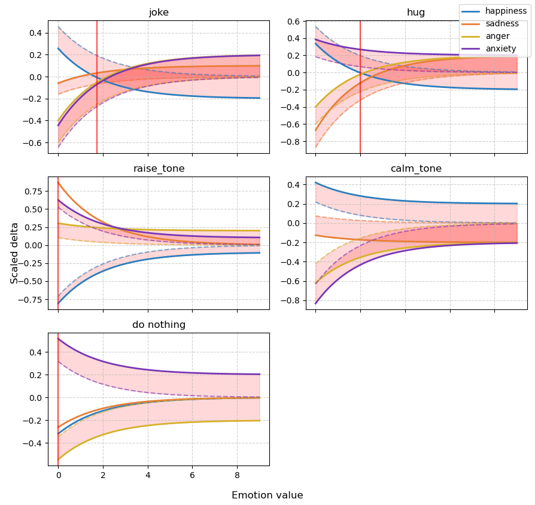
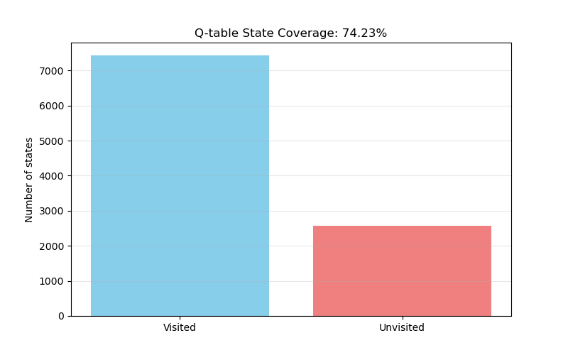
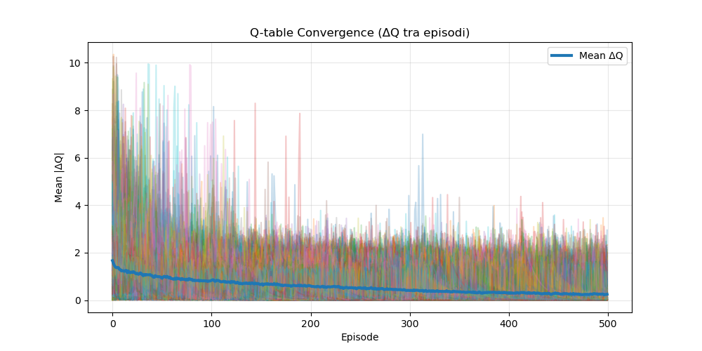
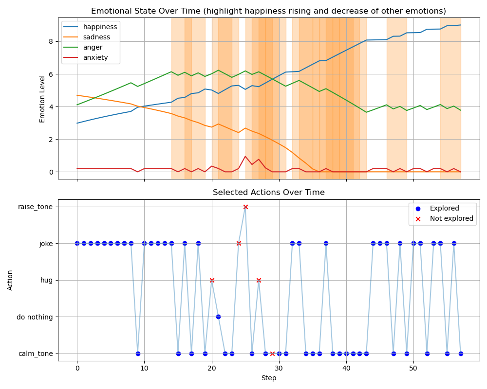
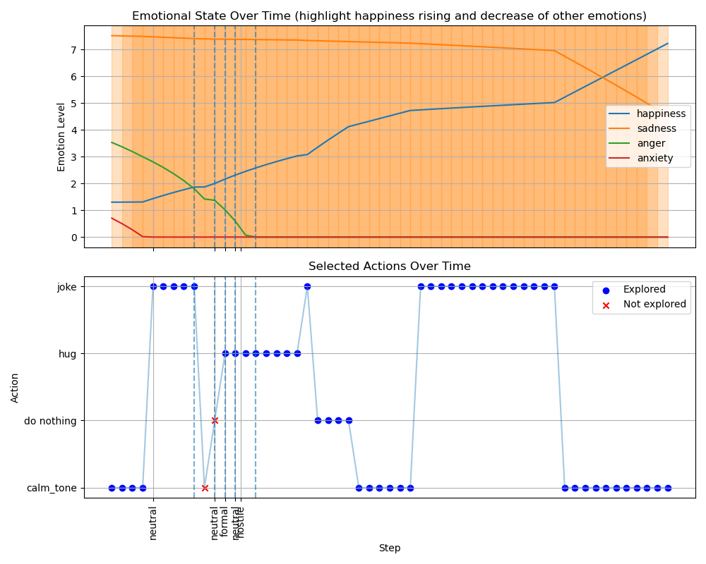
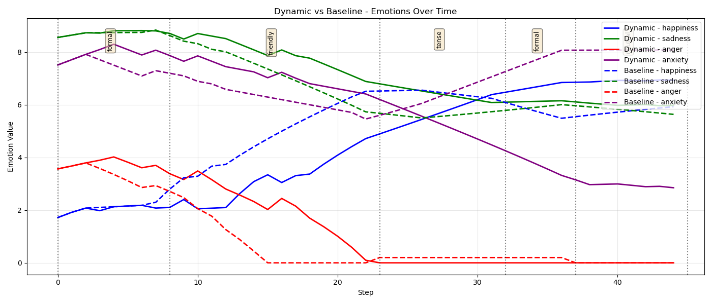

# RL & ASP Logic for Human–Machine Interaction

A context-aware agent that tries to **improve a human's emotional state** by combining
**Reinforcement Learning** (tabular Q-learning) with **Answer Set Programming** (ASP, via
[clingo](https://potassco.org/clingo/)).

- **RL** learns *how to act*: which action (joke, hug, calm tone, …) raises happiness and lowers
  sadness, anger and anxiety, given the person's current emotional state.
- **ASP** infers *where the agent is*: from observable cues (clothing, language, voice, noise,
  posture, …) it reasons symbolically about which social context (formal, friendly, tense, …) best
  explains the scene, and the agent switches to the policy trained for that context.

The adaptive agent is compared against a context-unaware baseline that always uses a single policy.

> University project — *Reinforcement Learning & ASP Integration*, Roberto Sonzini Gobbi, March 2026.
> The full write-up is in [`docs/report.pdf`](docs/report.pdf).

---

## Table of contents

1. [The problem](#1-the-problem)
2. [Agent–human–environment loop](#2-agenthumanenvironment-loop)
3. [Human model](#3-human-model)
4. [Social environments](#4-social-environments)
5. [RL agent (Q-learning)](#5-rl-agent-q-learning)
6. [ASP environment inference](#6-asp-environment-inference)
7. [Results](#7-results)
8. [Conclusions and future work](#8-conclusions-and-future-work)
9. [Repository structure](#9-repository-structure)
10. [Getting started](#10-getting-started)

---

## 1. The problem

As AI agents enter human-centred settings, optimising a formal objective is not enough: they have to
account for people's emotional and behavioural dynamics. This project designs an agent that observes
a person's emotions and acts to **maximise happiness while minimising negative emotions**.

Three difficulties shape the design:

- **Individual variability** — different people react differently to the same stimulus.
- **Context dependence** — the surrounding environment changes how a person responds to an action.
- **Ambiguous observations** — the same cues may be compatible with several environment models, so the
  agent must infer which one is most plausible.

The approach assumes a **fully observable** emotional state (the agent perceives emotions exactly),
uses RL for experiential learning, and uses ASP to produce a **ranked list of plausible
environments** from observations collected over time. The environment can also **change during a
session**, and the agent must adapt.

## 2. Agent–human–environment loop

The three components form a closed loop over discrete time steps:



At each step:

1. The **agent** observes the human's emotional state and picks an action from its learned policy.
2. The **environment** returns a feedback that depends on its type and on the action; it affects both
   the reward and the human.
3. The **human** updates their emotional state in response to the action and the context, producing
   the next observation.

## 3. Human model

The internal state of individual *i* at time *t* is a vector of four emotions, each in `[0, 9]`:

$$
s^{(i)}_t = \left[\, s_{\text{happiness}},\; s_{\text{sadness}},\; s_{\text{anger}},\; s_{\text{anxiety}} \,\right]^\top
$$

The agent can choose among five actions: `joke`, `hug`, `raise_tone`, `calm_tone`, `do nothing`.

**Shared sign, individual magnitude.** Every action has an intrinsic qualitative effect on each
emotion (positive, negative or neutral) that all individuals agree on — a joke is generally pleasant,
raising one's tone is not — but each person weighs it differently. For every action the per-emotion
deltas are sampled once per individual:

$$
\delta^{(i)}_{e}(a) \sim
\begin{cases}
\mathcal{U}(0.1,\ 1.0) & \text{positive effect on } e\\
\mathcal{U}(-1.0,\ -0.1) & \text{negative effect on } e\\
\mathcal{U}(-0.5,\ 0.5) & \text{neutral effect on } e
\end{cases}
$$

| Action       | Happiness | Sadness | Anger | Anxiety |
|--------------|:---------:|:-------:|:-----:|:-------:|
| `joke`       | +         | −       | −     | −       |
| `hug`        | +         | −       | −     | ~       |
| `raise_tone` | −         | +       | +     | +       |
| `calm_tone`  | ~         | ~       | −     | −       |
| `do nothing` | ~         | ~       | ~     | ~       |

**State transition.** The update is attenuated by the current emotion level and shifted by the
environment (⊙ = element-wise product, `exp` applied element-wise):

$$
s^{(i)}_{t+1} = s^{(i)}_t + \delta^{(i)}(a_t) \odot \exp\!\left(-\tfrac{s^{(i)}_t}{2}\right) + \delta_{\text{environment}}(a_t)
$$

This captures two properties:

1. **State-dependent actions** — the same joke helps more when someone is neutral than when they are
   already very happy (which motivates a state-based RL formulation).
2. **Strong emotions resist change** — the exponential term makes actions less effective as the
   corresponding emotion grows.



*State transition function of a sample human. The shaded band is the shift induced by the
environment; the red vertical line marks the threshold beyond which the action has a negative effect
on happiness.*

## 4. Social environments

Five contexts are modelled: **neutral, formal, friendly, tense, hostile**.
[`deviations.json`](src/deviations.json) defines, for every context and action, an extra
emotional deviation (normalised so that its largest component has magnitude 0.2). The same action can
therefore help in one context and backfire in another — for example, a joke in a formal meeting
versus among friends.

Each context is also associated with sets of **observable cues**
([`env_obs.json`](src/env_obs.json)), which are the input to the ASP layer:

| Context  | Example observations |
|----------|----------------------|
| formal   | well-dressed people, formal language, calm tone, rigid posture |
| friendly | casual clothing, smiles/laughter, close distance, casual language, calm tone |
| neutral  | mixed clothing, normal/low noise, chill posture |
| tense    | raised voices, rigid posture, low smiles, high noise |
| hostile  | insults, very raised voices, aggressive posture |

## 5. RL agent (Q-learning)

The agent learns a policy π : s → a with **tabular Q-learning**. The continuous state in ℝ⁴ is
discretised into unit bins per emotion (10⁴ = 10,000 states × 5 actions).

**Reward.** The reward combines the change in the human's emotions with the environment feedback:

$$
R = R_{\text{human}} + R_{\text{environment}}, \qquad
R_{\text{human}} = \sum_{e \in E} w^{\text{human}}_e\, \delta^{\text{human}}_e, \qquad
R_{\text{environment}} = \sum_{e \in E} w^{\text{env}}_e\, \delta^{\text{env}}_e
$$

| Weight            | happiness | sadness | anger | anxiety |
|-------------------|:---------:|:-------:|:-----:|:-------:|
| w<sup>human</sup> | 100       | −10     | −10   | −10     |
| w<sup>env</sup>   | 50        | −5      | −5    | −5      |

These weights gave good results empirically: happiness is strongly rewarded and negative emotions are
penalised.

**Averaged Q-tables.** Both the initial state and each person's reaction parameters are random, so
episodes are highly stochastic. Each episode is therefore run with a **new sampled individual**, and
the resulting Q-tables are **averaged**. The learned policy approximates the expected effect of each
action over a heterogeneous population while reducing the influence of outliers. One Q-table is
trained per context and saved in `q_tables.json`.

Exploration is ε-greedy with multiplicative decay (floor 0.05). Training covers a large part of the
discretised state space, and the mean Q-value update shrinks and stabilises across episodes:

| State-space coverage | Q-learning convergence |
|:---:|:---:|
|  |  |

## 6. ASP environment inference

RL learns good behaviour *within* a context, but it does not tell the agent *which* context it is in.
ASP adds a symbolic reasoning layer on top of RL because it:

- encodes domain knowledge as **interpretable rules and constraints**;
- reasons naturally under **incomplete information** (missing observations);
- supports **context switching** by selecting the best-fitting environment model;
- keeps **inference separate from policy learning**, so each RL policy can be specialised for one
  context (modularity and robustness).

The rules live in [`env_rules.lp`](src/env_rules.lp). Observations are added as facts,
e.g. `observed(voice(raised_voices)).`, and inference proceeds as follows:

1. **Observation matching** — collect cues: clothing, language, voice, personal space, faces, posture,
   ambient noise.
2. **Validation** — an environment is invalid if one of its required cues is missing:
   ```prolog
   invalid(E) :- required(E,X), not observed(X).
   ```
3. **Scoring** — each cue gives each environment a positive or negative score:
   ```prolog
   score(formal, clothing(well_dressed_people), 3).
   ```
4. **Total score**:
   ```prolog
   total_score(E,Total) :- environment(E), not invalid(E),
       Total = #sum { S,X : observed(X), score(E,X,S) }.
   ```
5. **Candidate selection** — only environments with a positive score are plausible:
   ```prolog
   possible(E) :- total_score(E,T), T > 0.
   ```
6. **Contribution analysis** (for explanation):
   ```prolog
   positive(E,X,S) :- contribution(E,X,S), S > 0.
   negative(E,X,S) :- contribution(E,X,S), S < 0.
   ```
7. **Best environment**:
   ```prolog
   best_score(M) :- M = #max { T,E : total_score(E,T), T > 0 }.
   best(E) :- total_score(E,T), best_score(T).
   ```

[`environment_solver.py`](src/environment_solver.py) runs clingo, collects `possible/1`
and `total_score/2`, and returns the candidates **ranked by score**. The first one is the best
guess, and its Q-table is loaded into the agent.

## 7. Results

The ASP-powered, context-switching agent is compared against a **baseline** Q-learning agent trained
on a single fixed context (`neutral`). The baseline faces the same human and the same sequence of
contexts, but it cannot adapt.

**Hypotheses**

- Even without context awareness, the RL agent generally increases human happiness over time.
- The ASP-enabled adaptive agent infers context changes and adapts, raising happiness faster and more
  effectively.
- The adaptive agent also reduces negative emotions more efficiently than the baseline.

**Single context.** With a policy trained for one context, the agent drives happiness close to the
maximum while sadness and anxiety fall. Orange regions mark steps where happiness is being maximised
and negative emotions minimised; red crosses mark actions taken in states never explored during
training.



**Dynamic session.** In a session with several context switches (dashed lines, labelled with the
inferred context), happiness rises steadily while anger and anxiety drop to zero.



**Context-aware vs. context-unaware.** Starting from the same cloned human, the adaptive agent (solid)
reaches higher happiness and lower anxiety than the baseline (dashed), especially once the contexts
diverge from the one the baseline was trained on.



The experiments confirm the hypotheses: the adaptive model consistently outperforms the baseline,
**except when different contexts produce very similar human responses**. The more the environments
diverge, the larger the advantage of context-aware modelling.

## 8. Conclusions and future work

Combining RL with ASP lets the agent infer its environment and adjust its actions, which leads to
higher happiness and better handling of negative emotions, particularly in dynamic, changing social
contexts.

Possible extensions:

- **Feature-based state representation** — replace discrete Q-tables with feature vectors / function
  approximation to handle larger, continuous state spaces.
- **Advanced ASP optimisation** — use `#maximize` and other optimisation statements to reason over
  candidates more directly and efficiently.
- **Combined observations** — weight combinations of cues (e.g. facial expression *and* posture) to
  catch subtler contextual signals.
- **Partial observability** — drop the assumption of perfectly perceived emotions and use belief-state
  tracking or probabilistic inference.
- **Dynamic environment adaptation** — handle sudden or continuous context changes beyond fixed time
  windows (lifelong adaptation).
- **Detecting wrong inferences** — monitor performance in the inferred context and fall back to the
  next candidate in the ASP ranking when results are poor.
- **Explainability** — use ASP's `positive/negative` contributions to explain why a context, and
  therefore a policy, was chosen.
- **More realistic interaction** — infer emotions from natural-language interaction.

## 9. Repository structure

```
.
├── src/                        # Implementation
│   ├── main.py                 # Train per-context Q-tables + dynamic session with context switches
│   ├── baseline.py             # Adaptive (ASP) agent vs. context-unaware baseline on the same human
│   ├── one_env_scenario.py     # Single-context training, analysis and statistical tests
│   ├── training.py             # Averaged-Q training loop, per-context and baseline training
│   ├── agent.py                # Q-learning agent: discretisation, ε-greedy, reward, Q-table I/O
│   ├── human.py                # Human emotional model and reactions
│   ├── environment.py          # Social environment feedback (from deviations.json)
│   ├── environment_solver.py   # clingo interface: observations → ranked environments (+ accuracy test)
│   ├── env_rules.lp            # ASP knowledge base (required cues, scores, inference rules)
│   ├── env_obs.json            # Observation sets per environment
│   ├── deviations.json         # Context-specific emotional deviations per action
│   ├── settings.json           # Value range, discretisation step, window sizes, agent hyper-parameters
│   ├── config.py               # Loads settings.json
│   ├── plots.py                # Plotting utilities
│   ├── function_state.py       # Small sketch to visualise an exponential attenuation function
│   ├── q_tables.json           # Pre-trained Q-tables, one per context
│   └── baseline_q_table.json   # Pre-trained baseline Q-table (neutral context)
├── docs/
│   └── report.pdf              # Project report
├── imgs/                       # Figures used in the report and in this README
├── requirements.txt
└── README.md
```

## 10. Getting started

### Requirements

Python 3.10+ with [`numpy`](https://numpy.org/), [`matplotlib`](https://matplotlib.org/) and
[`clingo`](https://pypi.org/project/clingo/):

```bash
git clone https://github.com/RobertoSonzini/RL-and-ASP-logic-for-HMI.git
cd RL-and-ASP-logic-for-HMI
pip install -r requirements.txt
```

### Running

The scripts load their data files with relative paths, so run them **from `src/`**:

```bash
cd src
```

| Command | What it does |
|---|---|
| `python environment_solver.py` | Samples a context, generates its observations, runs ASP inference and then tests accuracy on every observation set |
| `python main.py` | Trains one Q-table per context, then simulates a session with random context switches, where ASP picks the policy for each window |
| `python baseline.py` | Trains per-context and baseline Q-tables, then compares the adaptive agent with the baseline on the same human |
| `python one_env_scenario.py` | Trains on one random context and shows Q-table analysis and "until happy" simulations |

> ⚠️ `main.py` and `baseline.py` **retrain from scratch** (1000 episodes × 500–800 steps × 5 contexts)
> and overwrite `q_tables.json` / `baseline_q_table.json`, so they can take a while. Pre-trained tables
> are already included in the repository.

### Configuration

[`settings.json`](src/settings.json) controls the emotion range (`min_value`, `max_value`),
the discretisation `step_size`, the length of each context window in dynamic sessions
(`min_window_width`, `max_window_width`), and the default agent hyper-parameters (`epsilon`,
`decay_rate`, `learning_rate`, `discount_factor`). The training calls in `main.py` / `baseline.py`
override the agent defaults with ε = 0.3, decay = 0.995, α = 0.1 and γ = 0.3.
